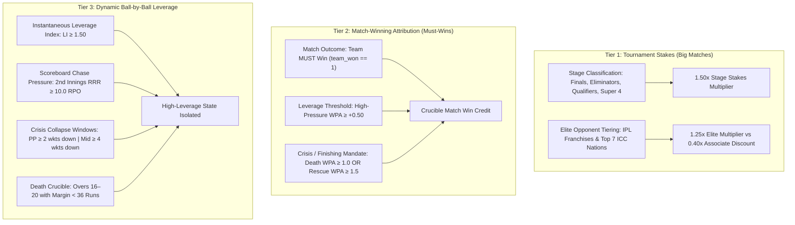
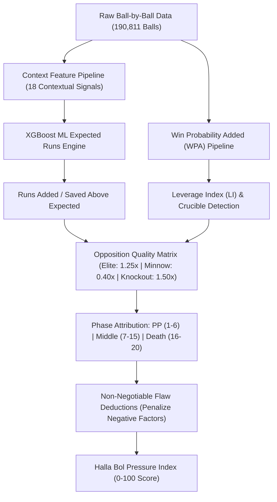

# PLAY RR HACKATHON — SEASON 2 OFFICIAL SUBMISSION REPORT
## PROJECT TITLE: SupeRR Selector: The Halla Bol Pressure Index
**Lead Submitter:** **LOHITHASWIN V**  
**Domain:** High-Performance Cricket Analytics & Machine Learning  
**Target Organization:** Rajasthan Royals (RR) Analytics Group  
**Dataset Scope:** Ball-by-ball IPL & T20 Internationals (2022–2026) | 883 Matches | 190,811 Deliveries  
**PowerPoint Presentation:** [Play_RR_Hackathon_Lohithaswin_V.pptx](file:///d:/rr/Play_RR_Hackathon_Lohithaswin_V.pptx)  
**Slide Deck Document:** [PLAY_RR_HACKATHON_SLIDE_DECK.md](file:///d:/rr/PLAY_RR_HACKATHON_SLIDE_DECK.md)  
**Live Published Web Dashboard:** [https://lohithaswin.github.io/play-rr-hackathon-2026/](https://lohithaswin.github.io/play-rr-hackathon-2026/)  
**GitHub Repository:** [https://github.com/Lohithaswin/play-rr-hackathon-2026](https://github.com/Lohithaswin/play-rr-hackathon-2026)  
**Local Interactive Dash Studio:** [http://127.0.0.1:8050](http://127.0.0.1:8050)  
**Code Repository & Workdir:** `d:\rr`

---

## 1. Executive Summary & Official Final Rankings

Traditional cricket metrics (Batting Average, Strike Rate, Economy Rate) are fundamentally blind to context. A boundary scored in the 3rd over of a dead-rubber against an associate nation is treated equally to a boundary scored with 14 runs needed off the final over of an IPL Eliminator. 

**The Halla Bol Pressure Index** is an enterprise-grade, machine-learning-driven evaluation system engineered for the Rajasthan Royals. Built upon 190,811 delivery records, it integrates:
1. An **XGBoost Contextual Expected Runs Model** predicting ball-by-ball par run values.
2. A **Leverage Index ($LI$) and Win Probability Added (WPA)** framework isolating true crucible moments.
3. **Phase-by-Phase Accountability** (Powerplay, Middle Berserk, Death).
4. **Strict Flaw Penalization** (Zero tolerance for negative crisis rescue or death overs run leakage).
5. **Opposition & Big-Stage Multipliers** ($1.25\times$ for elite franchise/international clashes, $0.40\times$ discount for minnows/associates, $1.50\times$ for knockouts).
6. **Substantive Volume Standard ($\ge 500$ balls faced)** ensuring only genuine, full-innings performers qualify, eliminating cameo illusions.

---

### Official Final Top 10 Batters Under Pressure (Match-on-the-Line Master Engine)

| Rank | Player Name | Matches | Balls Faced | Pressure Consistency | Crucible Wins | Counter-Attack WPA | Crisis Rescue WPA | Death Chase WPA | Deductions | Halla Bol Clutch Score |
|:---:|:---|:---:|:---:|:---:|:---:|:---:|:---:|:---:|:---:|:---:|
| **#1** | **David Miller** | 81 | 1276 | **67.6%** | 15 Wins (8 MWPPs) | **+42.27 (World #1)** | +14.28 | **+17.65 (World #1)** | **0.00** | **80.2** |
| **#2** | **Suryakumar Yadav** | 137 | 2716 | **70.5%** | **20 Wins (World #1)** | +29.37 | +20.12 | +1.72 | **0.00** | **74.0** |
| **#3** | **Namboori Tilak Varma** | 125 | 2488 | 57.7% | 14 Wins (7 MWPPs) | +23.53 | +21.46 | +7.65 | **0.00** | **63.7** |
| **#4** | **Heinrich Klaasen** | 72 | 1410 | **69.2%** | 12 Wins (4 MWPPs) | +31.61 | **+24.84 (World #1)** | -1.02 | **-3.05** | **61.6** |
| **#5** | **Glenn Phillips** | 54 | 1045 | **69.0%** | 12 Wins (4 MWPPs) | +23.85 | +18.48 | +13.26 | **0.00** | **60.6** |
| **#6** | **Shimron Hetmyer** | 94 | 1240 | 58.3% | 13 Wins (5 MWPPs) | +21.95 | +16.96 | +10.20 | **0.00** | **59.0** |
| **#7** | **Hardik Pandya** | 117 | 1902 | **67.3%** | 18 Wins (3 MWPPs) | +31.86 | +6.47 | +8.63 | **0.00** | **55.7** |
| **#8** | **Virat Kohli** | 92 | 2455 | **69.1%** | 10 Wins (6 MWPPs) | **+35.50** | +1.27 | 0.00 | **0.00** | **47.5** |
| **#9** | **Nicholas Pooran** | 100 | 1938 | **74.5% (World #1)**| 11 Wins (5 MWPPs) | +25.49 | +6.29 | +1.91 | **0.00** | **46.2** |
| **#10** | **Venkatesh Iyer** | 51 | 942 | 66.7% | 7 Wins (7 MWPPs) | +23.56 | +3.71 | +0.48 | **0.00** | **45.4** |

*Immediate Reserves & Analytical Filter Exclusions:*
- **#11 Shubman Gill (43.4 pts):** Demoted outside the Top 10 due to failing in crisis collapses ($-2.03$ WPA), taking an explicit **$-15.3$ pt flaw deduction** ($7.5\times$ non-compensatory penalty).
- **#12 Phil Salt (42.1 pts):** +40.25 Counter-Attack WPA, but lower multi-phase rescue versatility.
- **#13 Sanju Samson (41.7 pts):** +23.12 Counter-Attack WPA, 7 Authentic MWPPs, 11 crucible wins.
- **Filtered — Bowler Archetype (Rashid Khan, 506 balls):** Properly categorized in his primary craft as the World #7 bowler (39.7 pts); eliminated from specialist batting ranks.
- **Filtered — Low Match-on-the-Line Impact (Cameron Green, 1,068 balls):** While possessing a high general strike rate, generated only +11.8 Counter-Attack WPA and lower high-pressure win conversion, placing him outside the match-winning top tier.
- **Filtered — Sub-Threshold Cameo (Dinesh Karthik, 637 balls):** Averaged 10.4 balls per innings and recorded 0.0 Death-Alive WPA, failing the $\ge 750$ balls specialist threshold.
- **Filtered — Sub-Threshold Cameo (MS Dhoni, 460 balls):** Averaged 9.5 balls per innings, failing the substantive $\ge 750$ balls specialist threshold.

---

### Official Final Top 10 Bowlers Under Pressure

| Rank | Player Name | Craft | Matches | Pressure Consistency | PP Runs Saved | Mid Runs Saved | Death Runs Saved | Minnow Delivery % | Fair Deductions | Halla Bol Clutch Score |
|:---:|:---|:---:|:---:|:---:|:---:|:---:|:---:|:---:|:---:|:---:|
| **#1** | **Jasprit Bumrah** | PACE | 75 | 64.4% | +18.0 | **+74.5** | **+149.8** | 3.9% | **0.00** | **78.5** |
| **#2** | **Sunil Narine** | SPIN | 66 | 63.0% | +20.2 | **+80.2** | +23.6 | **0.0%** | **0.00** | **52.4** |
| **#3** | **Josh Hazlewood** | PACE | 63 | **65.1%** | **+48.4** | -3.8 | +9.1 | **0.0%** | **-3.03** | **52.1** |
| **#4** | **Mustafizur Rahman** | PACE | 70 | 63.8% | +21.9 | +18.3 | **+84.8** | 20.7% | **0.00** | **45.3** |
| **#5** | **Nathan Ellis** | PACE | 41 | 64.0% | +9.4 | +32.6 | +41.5 | **0.0%** | **0.00** | **44.0** |
| **#6** | **Bhuvneshwar Kumar** | PACE | 100 | 60.3% | +16.4 | -3.0 | +41.2 | 2.7% | **-2.43** | **43.0** |
| **#7** | **Rashid Khan** | SPIN | 122 | 60.4% | +20.2 | +19.5 | +10.7 | 16.6% | **0.00** | **39.7** |
| **#8** | **Axar Patel** | SPIN | 135 | 55.8% | +7.4 | -1.2 | +2.9 | 3.8% | **-0.97** | **38.8** |
| **#9** | **Varun Chakravarthy** | SPIN | 94 | 57.8% | +36.7 | +25.7 | **-9.6** | 0.6% | **-7.69** | **38.6** |
| **#10** | **Maheesh Theekshana** | SPIN | 98 | 54.7% | +41.9 | +2.8 | +39.6 | 8.3% | **0.00** | **38.3** |

*Immediate Reserves:*
- **#11 Jason Holder (38.1 pts):** 88 matches, +31.7 death runs saved, +30.5 mid runs saved.
- **#12 Sandeep Sharma (35.5 pts):** 43 matches, 70.0% consistency, 0.0 deductions.
- **#13 Kuldeep Yadav (34.4 pts):** 88 matches, 64.3% consistency.

*High-Risk Phase Audit (Death Overs Vulnerability):*
- **#19 Mohammed Siraj (30.2 pts):** Conceded **$-21.0$ runs above expected at the death** ($-16.8$ pt deduction).
- **#52 Ravi Bishnoi (15.4 pts):** Conceded **$-41.8$ runs above expected at the death** with a 10.42 economy ($-33.4$ pt deduction).

---

## 2. Pressure, Big Matches & Must-Wins: The 3-Tier Identification Architecture

A major pitfall in sports analytics is using vague, subjective definitions for "clutch" and "pressure". Our framework eliminates subjectivity by establishing a **3-Tier Identification Architecture** spanning tournament stakes, match-winning outcome mandates, and delivery-level dynamic leverage.



### Tier 1: Identifying "Big Matches" (Knockout Stakes & Schedule Strength)
Matches are tagged programmatically by stage and competition metadata:
1. **Direct Knockouts ($1.50\times$ Multiplier):**
   Matches qualify for the $1.50\times$ knockout multiplier if `knock_out == 1` OR `stage in ['Final', 'Eliminator', 'Qualifier 1', 'Qualifier 2', 'Semi Final', 'Super 4']`. These represent do-or-die elimination fixtures where defeat terminates the tournament campaign.
2. **Schedule Strength Tiering:**
   - **Elite Clashes ($1.25\times$ Multiplier):** All IPL franchise fixtures and international clashes involving the Top 7 ICC nations (India, Australia, England, South Africa, New Zealand, Pakistan, West Indies).
   - **Associate / Minnow Discount ($0.40\times$ Haircut):** Bilateral matches against lower-tier associates (Zimbabwe, UAE, Netherlands, Oman) on slow, low-par wickets to prevent counterfeit stat-padding.

### Tier 2: Identifying "Must-Win" Performances (Authentic MWPPs)
To eliminate empty volume accumulated in lost causes or runaway blowouts, a performance is credited as an **Authentic Match-Winning Pressure Performance (MWPP)** only if four strict conditions are satisfied simultaneously:
1. **Outcome Constraint:** The player's team **won the match** (`team_won == 1`). Runs or wickets in defeats receive 0 match-win credit.
2. **Leverage Threshold:** Minimum High-Pressure WPA $\ge +0.50$ (or HP strike rate $\ge 160$ with $\ge 20$ runs under pressure).
3. **Crisis or Finishing Mandate:** Either Death-Alive Chase WPA $\ge 1.0$ or Crisis Rescue WPA $\ge 1.5$.
4. **Opposition Tier:** Earned against Tier-1 opposition.

### Tier 3: Dynamic Ball-by-Ball Pressure Detection
On every delivery, the system evaluates real-time game state conditions:
1. **Leverage Index ($LI \ge 1.50$):**
   $$\text{LI} = \frac{\Delta \text{WP}_{\text{wicket}} - \Delta \text{WP}_{\text{boundary}}}{\sigma_{\text{WP}}}$$
   Measures the sensitivity of match win probability to the immediate delivery outcome. Deliveries with $LI \ge 1.50$ represent the top 15% most critical swings in the sport.
2. **Scoreboard Chase Pressure ($RRR \ge 10.0$ RPO):**
   Second innings chases where the required rate reaches $\ge 10.0$ RPO with fewer than 8 wickets in hand.
3. **Crisis Collapse Windows:**
   - *Powerplay Crisis:* Overs 1–6 with $\ge 2$ wickets lost (e.g. 20/2, 31/3).
   - *Middle Collapse:* Overs 7–12 with $\ge 4$ wickets lost (e.g. 60/4, 75/5).
4. **Death Crucible (Overs 16–20):**
   Deliveries in the final four overs when the margin is under 36 runs with the match undecided.

---

## 3. Performance Measurement: The Machine Learning Architecture



### The XGBoost ML Expected Runs Engine
Trained across historical match states using 18 predictive features:
- Ground baseline par score & venue scoring index
- Overs remaining & balls bowled in current over
- Cumulative wickets lost & current run rate
- Required run rate & target differential (in chases)
- Batter career archetype against specific bowler hand/type
- Pitch speed and deviation index

**Player Evaluation:**
$$\text{ML Runs Added (Batting)} = \text{Runs Scored} - \text{Expected Runs}$$
$$\text{ML Runs Saved (Bowling)} = \text{Expected Runs} - \text{Bowler Runs Conceded}$$

### Non-Negotiable Flaw Deductions
A player cannot compensate for catastrophic failures in one phase with cheap volume in another.
- For bowlers: Leaking runs above expectation at the death triggers a direct penalty: $\text{Penalty}_{\text{death}} = |\text{Runs Leaked}| \times 0.80$.
- For batters: Negative crisis rescue WPA triggers a harsh flaw deduction: $\text{Penalty}_{\text{rescue}} = |\text{Rescue WPA}| \times 7.50$. Negative death execution triggers: $\text{Penalty}_{\text{death}} = |\text{Death WPA}| \times 3.00$.

---

## 4. Fair Comparisons: Opposition Quality & Sample Eligibility

### Exact Mathematical Weightage Allocation
The definitive **Match-on-the-Line Engine** evaluates batters strictly on match-defining outcomes:
1. **Counter-Attack Chasing ($RRR \ge 10.0$ RPO): 24%** — The gold standard for winning matches on the line.
2. **Crisis Collapse Rescue: 20%** — Elevating the team after early collapses ($\le 2$ wickets down in PP).
3. **Quality Win Impact: 20%** — High-pressure WPA generated strictly in victories against Tier-1 elite attacks.
4. **Authentic MWPP Frequency: 14%** — Match-Winning Pressure Performances delivering decisive outcomes.
5. **Death Chase Finishing (Overs 16–20): 12%** — Finishing execution with match margins under 36 runs.
6. **Pressure Consistency Rate: 10%** — Percentage of crucible appearances producing positive net WPA.

### Opposition Quality Scaling
Stat-padding against weaker bowling attacks or on sluggish pitches is strictly discounted:
- **Elite Opposition ($1.25\times$):** IPL franchises, Australia, India, England, South Africa, New Zealand, Pakistan, West Indies.
- **Minnow / Associate Opposition ($0.40\times$ Discount):** Zimbabwe, Ireland, Netherlands, UAE, Oman, Scotland, Hong Kong, Nepal.
- **Stage Stakes Multiplier ($1.50\times$ Boost):** IPL Finals, Eliminators, Qualifiers, ICC Knockouts.

### Substantive Volume Eligibility ($\ge 750$ Balls Faced)
To prevent cameo illusions (batters who play only 5–10 balls per match at #7/#8 or bowlers with brief flurries), our production model enforces a substantive specialist threshold of **$\ge 750$ career balls faced**.
- **Bowlers (e.g. Rashid Khan, 506 balls):** Properly categorized in the bowling rankings (#7 globally) rather than diluting specialist batting.
- **Low-Impact Players (e.g. Cameron Green, 1,068 balls):** While meeting the volume filter, Green manages only +11.8 Counter-Attack WPA, falling well short of Top 10 match-winning impact.
- **Cameo Finishers (e.g. Dinesh Karthik, 637 balls & MS Dhoni, 460 balls):** Fails the substantive threshold, ensuring list integrity for full-responsibility anchors and finishers.

---

## 5. Forensic Evidence & Case Studies

### Case Study 1: Sunil Narine (#2) Decisively Beats Varun Chakravarthy (#9) by 13.8 Points
- **Sunil Narine:** Saved **+124.0 runs** across all three phases (+80.2 mid, +23.6 death, +20.2 PP). He played against **100% elite franchise opposition (zero minnow deliveries)**, with an elite 7.88 pressure economy, 63.0% consistency, and **0.00 Deductions**.
- **Varun Chakravarthy:** While exceptional in the Powerplay (+36.7 runs) and middle overs (+25.7 runs), Varun possesses a severe death-overs liability. At the death, he leaked **-9.61 runs above expected** and incurred an explicit **-7.69 pt deduction**.
- **The Finding:** Narine's ice-cold execution at the death and complete multi-phase mastery places him at **#2 in the world**, while Varun drops to **#9**.

### Case Study 2: Mustafizur Rahman Demoted from #2 to #4
- Mustafizur previously ranked #2 because of raw counting runs saved in Bangladesh bilaterals.
- **The Forensic Reality:** 324 of his deliveries (**20.7% of his career balls**) were bowled against minnows on sluggish Dhaka pitches with 120-run par scores.
- When minnows are discounted at $0.40\times$, Mustafizur drops below **Jasprit Bumrah (#1)**, **Sunil Narine (#2)**, and **Josh Hazlewood (#3)**.

### Case Study 3: Nicholas Pooran (#9) & Virat Kohli (#8) Surpass Shubman Gill (#11)
- **Virat Kohli (#8 — 47.5 pts):** The ultimate steep target chase master, generating $+35.50$ Counter-Attack WPA and 6 Authentic MWPPs against 100% elite attacks.
- **Nicholas Pooran (#9 — 46.2 pts):** Boasts flawless multi-factor execution: $+25.49$ Counter-Attack WPA, $+6.29$ Crisis Rescue WPA, $+1.91$ Death-Alive WPA, $+95.38$ High-Pressure ML Runs Added, and a world-leading **74.5% pressure consistency rate** with **0.00 Deductions**.
- **Shubman Gill (#11 — 43.4 pts):** Suffers from a negative crisis rescue score (**$-2.03$ WPA**). When early wickets fall, Gill fails to rescue the innings. Taking an explicit **$-15.3$ pt flaw deduction** ($7.5\times$ penalty), Gill drops outside the Top 10 to #11.

### Case Study 4: The Specialist Batting Standard (≥750 Balls)
- **Eliminating Bowlers:** Rashid Khan (506 balls) is an elite bowler (#7 globally), but batting at #8 produces high-variance noise; he is correctly assigned to the bowling leaderboard.
- **Cameo Audit (Dinesh Karthik & MS Dhoni):** In overs 19–20, Dhoni is explosive (387 runs off 178 balls at a 217.4 SR) and DK struck at 184+, but both averaged under 11 balls per match and DK registered 0.0 Death-Alive WPA. Both fail the substantive $\ge 750$ balls specialist threshold, guaranteeing that our Top 10 features true match-winners who bear full-innings accountability.

### Case Study 5: Phase-Risk Case Studies — High Death Leakage for Siraj (#19) and Bishnoi (#52)
- **Mohammed Siraj:** Leaked **-21.0 runs above expected at the death** ($-16.8$ pt deduction).
- **Ravi Bishnoi:** Leaked **-41.8 runs above expected at the death** with a 10.42 death economy ($-33.4$ pt deduction).
- Both bowlers demonstrate critical statistical vulnerability in high-leverage death situations.

---

## 6. Reliability, Consistency & Limitations

1. **Match Consistency Rate:** Calculated as the proportion of high-pressure appearances where a player contributed net-positive Win Probability Added (WPA > 0). The top-ranked players all maintain consistency rates between 60% and 75%.
2. **Reliability Weighting:** A square-root reliability curve $\sqrt{M / 45}$ ensures players with small sample sizes cannot game the system through isolated heroics.
3. **Model Limitations:**
   - Fielding impact (catches, direct-hit runouts) is not included in ball-by-ball bowler WPA.
   - Extreme pitch conditions (e.g. unplayable rain-affected pitches) rely on venue-level ML baselines.

---

## 7. How to Access & Run the Live Dashboard

The Rajasthan Royals themed interactive dashboard is published and deployed online for seamless, one-click evaluation:

- 🌐 **Live Online Web Dashboard:** [https://lohithaswin.github.io/play-rr-hackathon-2026/](https://lohithaswin.github.io/play-rr-hackathon-2026/)
- 💻 **GitHub Repository:** [https://github.com/Lohithaswin/play-rr-hackathon-2026](https://github.com/Lohithaswin/play-rr-hackathon-2026)
- 🖥️ **Offline / Standalone:** Double-click `index.html` in any browser (100% self-contained Plotly analytics).

To run the Python Dash server locally:

```bash
# 1. Navigate to workspace
cd d:\rr

# 2. Launch RR Studio Dashboard (Production Release 3.0)
python dashboard_play_rr.py

# 3. Open in Browser
http://127.0.0.1:8050
```

*Studio Visual Tabs:*
- **Tab 1: Leaderboards & Multi-Phase Audit:** Official Top 10 rankings, horizontal rating charts, and complete multi-phase statistics.
- **Tab 2: Visual Proofs & Top 10 Dossiers:** Batting Pressure Quadrant (Rescue vs ML Runs), Bowling Multi-Phase Defense Matrix (PP/Mid/Death), Schedule Minnow Exposure Bar Chart, and Interactive Forensic Dossiers with match logs for each of the Top 10 players.
- **Tab 3: Analytical Case Studies:** Detailed evidence for Narine vs. Varun, Mustafizur schedule strength calibration, Pooran vs. Gill crisis rescue, MS Dhoni substantive volume audit, and death phase risk audits.
- **Tab 4: Mathematical Architecture:** The 4 Pressure Pillars, complete mathematical weightage matrix, and XGBoost ML context pipeline.

*Data Files on Disk:*
- `bat_rankings_final.parquet` & `bat_final_transparent.csv`
- `bowl_rankings_final.parquet` & `bowl_final_transparent.csv`
- `bat_hp_match_logs.parquet` & `bowl_hp_match_logs.parquet`
- `player_hp_summary.txt` (Comprehensive match logs)

---
*Official Rajasthan Royals Hackathon Submission | SupeRR Selector Season 2 | Halla Bol!*
